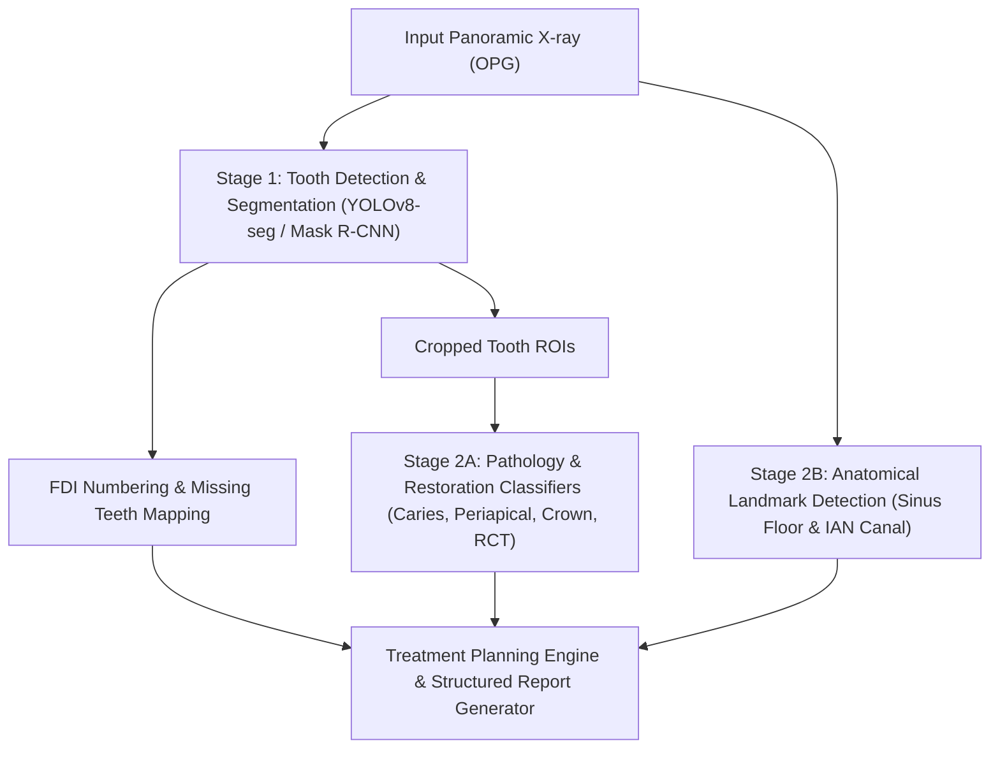

# Dental AI Screening

AI-powered panoramic X-ray (OPG) screening system for pre-consultation dental assessments and preliminary treatment plan generation.

## 📌 Overview

Dental AI Screening is an automated diagnostic and assessment pipeline designed to analyze panoramic dental radiographs (OPG / Orthopantomogram). The system provides automated tooth-level findings and implant site evaluations to streamline patient intake and clinical consultation.

### Key Detection Targets

| Target | Description | Category |
|--------|-------------|----------|
| **Tooth Detection & FDI Numbering** | Individual tooth segmentation & FDI classification (11-48) | Core / MVP |
| **Missing Teeth Detection** | Dental arch gap analysis mapped to missing FDI numbers | Core / MVP |
| **Caries (Cavities)** | Radiolucent lesion detection on enamel and dentin surfaces | Pathology / MVP |
| **Periapical Lesions** | Radiolucent rounded infection zones at root apex | Pathology / MVP |
| **Existing Crowns** | Radiopaque prosthetic crown identification | Restoration / MVP |
| **Root Canal Treatments (RCT)** | Radiopaque filling material within root canal systems | Restoration / MVP |
| **Sinus Assessment (Maxilla)** | Residual bone height measurement below maxillary sinus floor | Implant Site Assessment |
| **Nerve Assessment (Mandible)** | Safety margin calculation above the Inferior Alveolar Nerve (IAN) | Implant Site Assessment |

---

## 🏗 System Architecture

The pipeline uses a multi-stage vision architecture:



1. **Stage 1 — Tooth Segmentation & Numbering**: Localizes each individual tooth, predicts masks, assigns FDI numbers, and identifies gaps for missing teeth.
2. **Stage 2A — Per-Tooth Pathology & Restorations**: Evaluates cropped tooth regions of interest (ROIs) for caries, periapical lesions, crowns, and root canals.
3. **Stage 2B — Anatomical Landmark Regression**: Traces the maxillary sinus floor and mandibular nerve canal to compute residual bone heights.
4. **Report Generation**: Aggregates tooth-level findings into a structured summary for clinical review.

---

## 🚀 Getting Started

### Prerequisites
- Python 3.10+
- PyTorch with CUDA support (recommended for GPU inference)

### Installation
```bash
# Clone the repository
git clone https://github.com/bryanedge7/dental-ai-screening.git
cd dental-ai-screening

# Create and activate virtual environment
python -m venv .venv
# Windows:
.venv\Scripts\activate
# Linux/macOS:
source .venv/bin/activate

# Install dependencies
pip install -r requirements.txt
```

---

## 📄 License
Proprietary / All rights reserved.
